# Panduan Pengguna IDN CARE

**Panduan lengkap untuk Mahasiswa, Admin Sarpras, Admin Kemahasiswaan, dan Super Admin**
Versi 1.0 · 20 November 2026

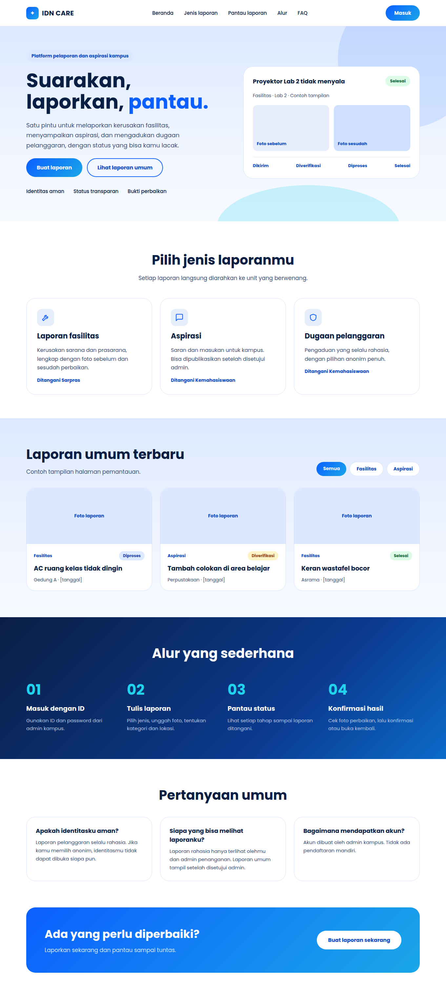

> Gambar di panduan ini adalah ilustrasi rancangan layar yang disertakan dalam repositori. Letak tombol atau tampilan dapat berubah mengikuti versi aplikasi. Jangan memakai data contoh pada ilustrasi sebagai data akun atau laporan sungguhan.

## Isi panduan

1. Memahami IDN CARE dan aturan akses
2. Masuk, ganti password, navigasi, dan notifikasi
3. Panduan Mahasiswa
4. Panduan Admin Sarpras
5. Panduan Admin Kemahasiswaan
6. Panduan Super Admin
7. Alur bersama: apa yang terjadi setelah laporan dikirim
8. Pemecahan masalah dan praktik privasi

## 1. Memahami IDN CARE dan aturan akses

IDN CARE adalah portal kampus untuk melaporkan kerusakan fasilitas, menyampaikan aspirasi, dan melaporkan dugaan pelanggaran. Setiap laporan memiliki tiket dan riwayat status. Sistem mengirim laporan ke unit sesuai jenisnya.

| Jenis laporan | Unit tujuan | Yang dapat ditangani |
|---|---|---|
| Fasilitas | Sarpras | Mahasiswa, Admin Sarpras, Super Admin |
| Aspirasi | Kemahasiswaan | Mahasiswa, Admin Kemahasiswaan, Super Admin |
| Dugaan pelanggaran | Kemahasiswaan | Mahasiswa, Admin Kemahasiswaan, Super Admin |

Admin unit hanya melihat laporan dalam kewenangannya. Super Admin dapat melihat dan mengelola semua laporan, tetapi **tidak dapat membuka identitas pelapor anonim pada laporan pelanggaran**. Laporan pelanggaran selalu rahasia; laporan ini tidak muncul pada pemantauan umum. Laporan fasilitas dan aspirasi baru dapat dilihat publik jika pelapor meminta visibilitas umum dan admin menyetujuinya.

## 2. Masuk, ganti password, navigasi, dan notifikasi

### Langkah 1 — Masuk ke akun
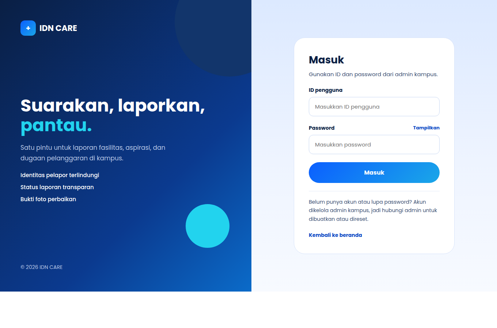

1. Buka halaman IDN CARE dan pilih **Masuk**.
2. Masukkan ID pengguna serta password yang diberikan pengelola akun.
3. Tekan tombol masuk. Anda akan diarahkan ke dashboard berdasarkan role akun.
4. Jika ini login pertama dan akun meminta penggantian password, selesaikan tahap berikut sebelum memakai menu lain.

### Langkah 2 — Ganti password awal atau password akun
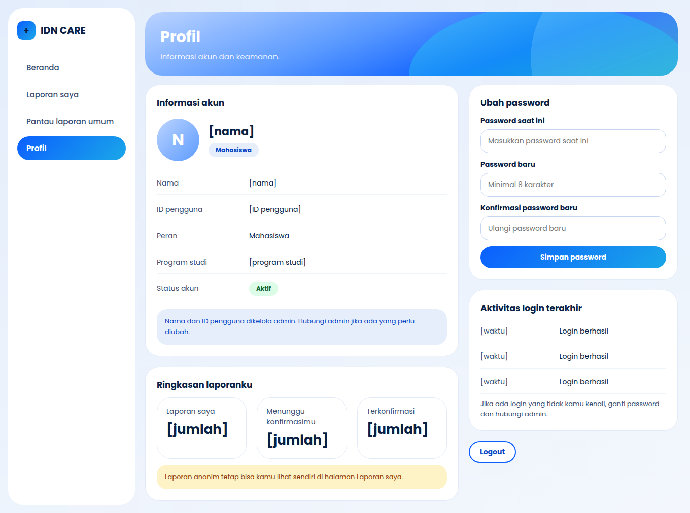

1. Isi password saat ini, password baru, dan konfirmasi password baru.
2. Password baru minimal 8 karakter, harus sama dengan konfirmasi, dan berbeda dari password saat ini.
3. Tekan **Simpan/Ganti password**. Setelah berhasil, aplikasi memberi notifikasi dan mengarahkan Anda ke dashboard role.
4. Simpan password baru secara aman. Jangan membagikan password lewat laporan atau tangkapan layar.

### Langkah 3 — Gunakan navigasi, tema, dan notifikasi
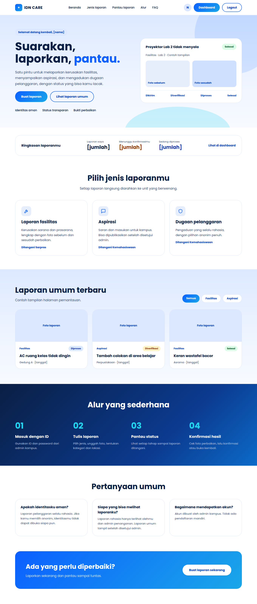

1. Gunakan sidebar atau menu navigasi untuk membuka Dashboard, Laporan saya, Buat laporan, Pemantauan, Notifikasi, Pengaturan, Profil, atau menu admin yang memang diizinkan.
2. Tombol tema pada topbar berganti antara tampilan terang dan gelap. Preferensi tampilan dapat dibuka dari **Pengaturan**.
3. Buka **Notifikasi** untuk membaca pemberitahuan. Notifikasi yang belum dibaca dapat ditandai sudah dibaca.
4. Tekan **Keluar** untuk mengakhiri sesi.

## 3. Panduan Mahasiswa

### Langkah 1 — Tinjau dashboard
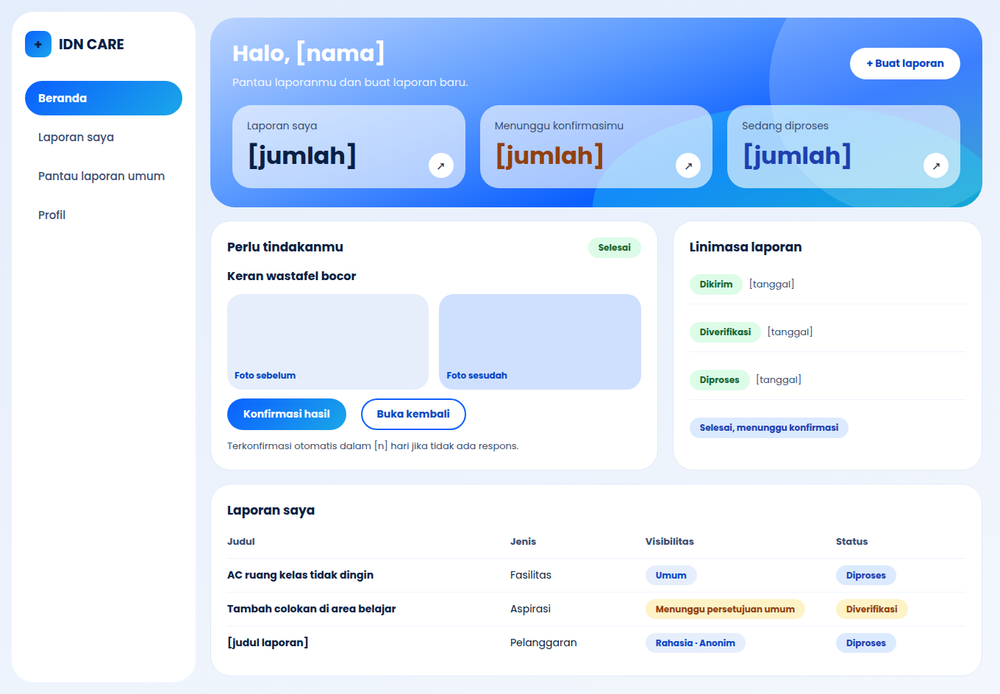

Dashboard merangkum jumlah dan status laporan milik Anda. Dari dashboard, buka daftar laporan, mulai laporan baru, atau lihat laporan umum yang telah disetujui. Menu yang sedang dinonaktifkan oleh Super Admin tidak dapat dipakai untuk mengirim laporan baru.

### Langkah 2 — Pilih jenis laporan
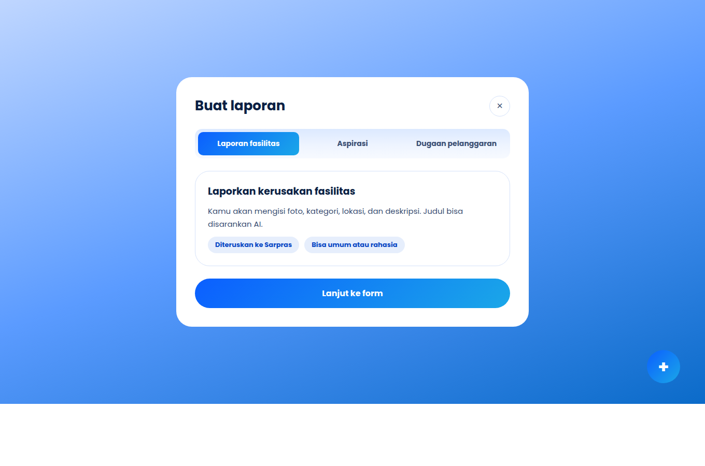

1. Tekan **Buat laporan** di navigasi atau tombol pintas dashboard.
2. Pilih **Laporan Fasilitas**, **Aspirasi**, atau **Laporan Dugaan Pelanggaran**.
3. Pilih **Lanjut ke form**. Jika jenis laporan sedang ditutup, hubungi admin atau pilih jenis lain yang masih aktif.

### Langkah 3 — Isi laporan fasilitas
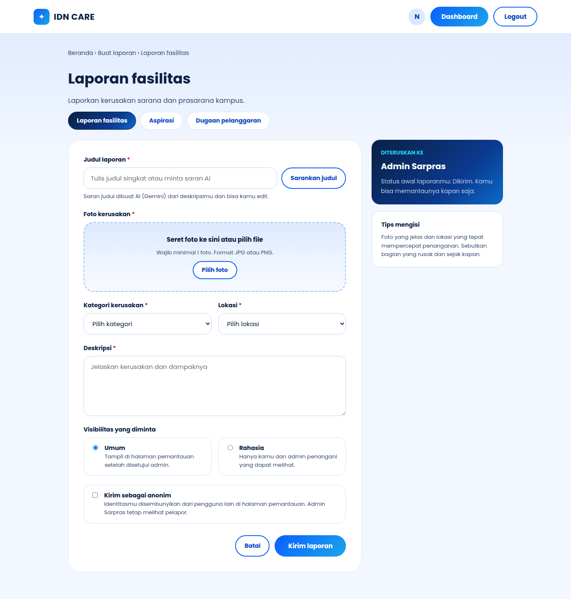

1. Isi judul dan uraian masalah dengan jelas.
2. Pilih kategori fasilitas yang aktif dan lokasi kejadian.
3. Unggah minimal satu foto kondisi awal. Format JPG/JPEG/PNG; maksimal 5 foto dan 4 MB per foto. Periksa pratinjau, lalu gunakan tombol **×** pada foto yang memang ingin dihapus.
4. Tentukan permintaan visibilitas umum atau rahasia dan pilihan anonim jika tersedia.
5. Periksa ringkasan, lalu tekan **Kirim laporan**. Simpan nomor tiket dari halaman Laporan saya.

### Langkah 4 — Isi aspirasi
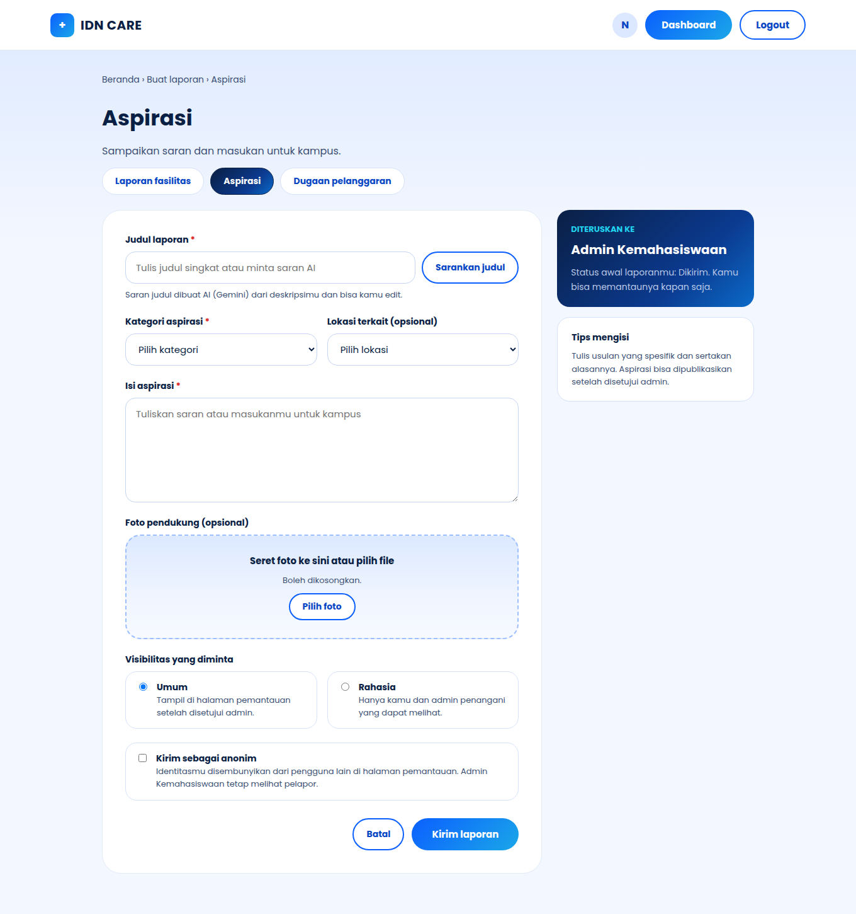

1. Isi judul, uraian usulan, kategori aspirasi aktif, dan lokasi bila diminta pada form.
2. Lampiran foto bersifat pilihan. Anda dapat meminta laporan umum atau rahasia dan memilih anonim.
3. Saran judul otomatis bersifat opsional. Jika saran tidak tersedia, tulis judul sendiri; pengiriman laporan tetap dapat dilakukan.
4. Kirim laporan dan catat tiket. Aspirasi diteruskan kepada Admin Kemahasiswaan.

### Langkah 5 — Isi laporan dugaan pelanggaran
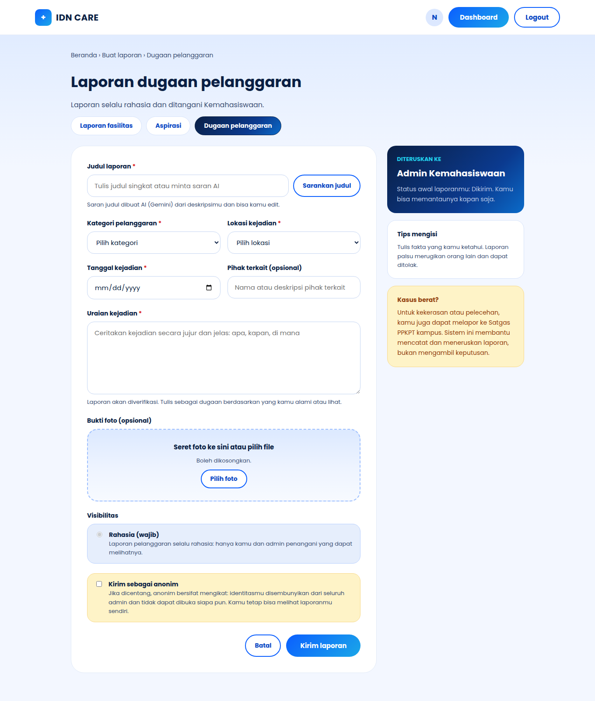

1. Berikan uraian faktual, tanggal kejadian, kategori aktif, dan lokasi kejadian.
2. Isi pihak terkait bila informasi tersebut diketahui dan relevan. Lampiran foto dapat ditambahkan bila aman dan diperlukan.
3. Laporan ini selalu rahasia. Form tidak menyediakan permintaan publikasi umum karena identitas serta isi laporan harus dilindungi.
4. Jika memilih anonim, identitas pelapor tidak ditampilkan kepada admin mana pun, termasuk Super Admin. Kirim hanya informasi yang memang aman untuk dicatat.
5. Kirim dan simpan nomor tiket untuk melacak laporan sendiri.

### Langkah 6 — Lihat Laporan saya dan detail laporan
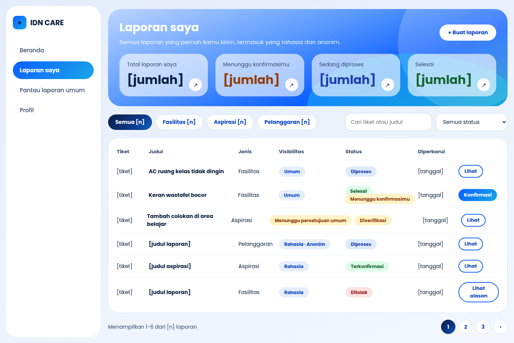

1. Buka **Laporan saya**. Gunakan filter jenis/status atau kolom pencarian untuk menemukan tiket.
2. Pilih sebuah tiket untuk membuka detail, foto yang boleh diakses, catatan, dan riwayat status.
3. Laporan anonim tetap terlihat oleh pemilik akun pada daftar pribadinya.

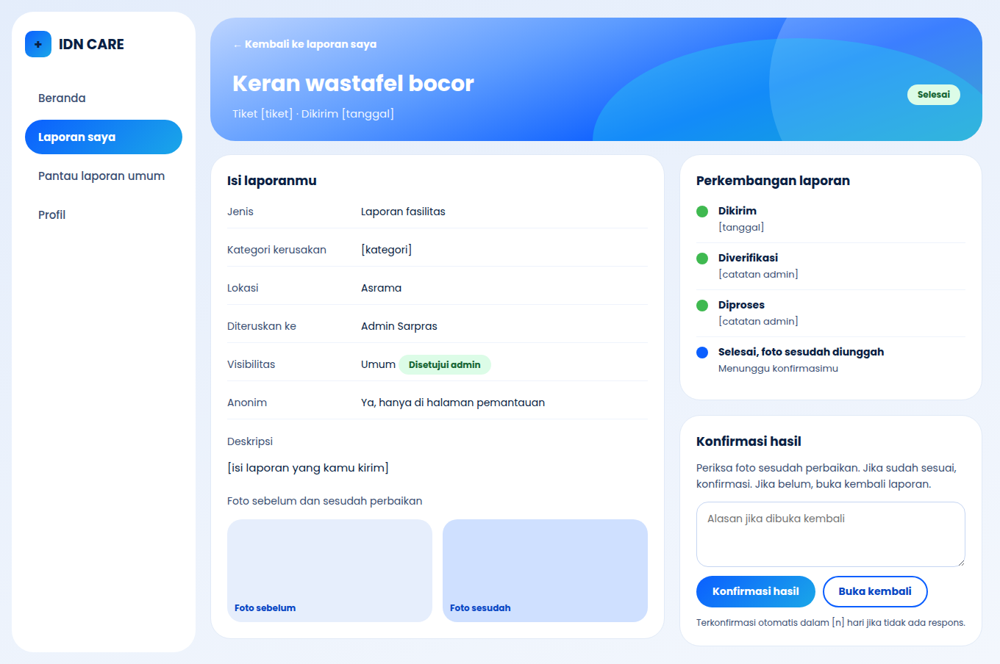

Riwayat menunjukkan tahap dan waktu perubahan bila tersedia. Status umumnya bergerak dari **Dikirim → Diverifikasi → Diproses → Selesai**, atau **Ditolak** dengan alasan. Foto sesudah perbaikan pada laporan fasilitas hanya dapat diakses melalui halaman yang memeriksa izin.

### Langkah 7 — Konfirmasi atau buka kembali laporan selesai
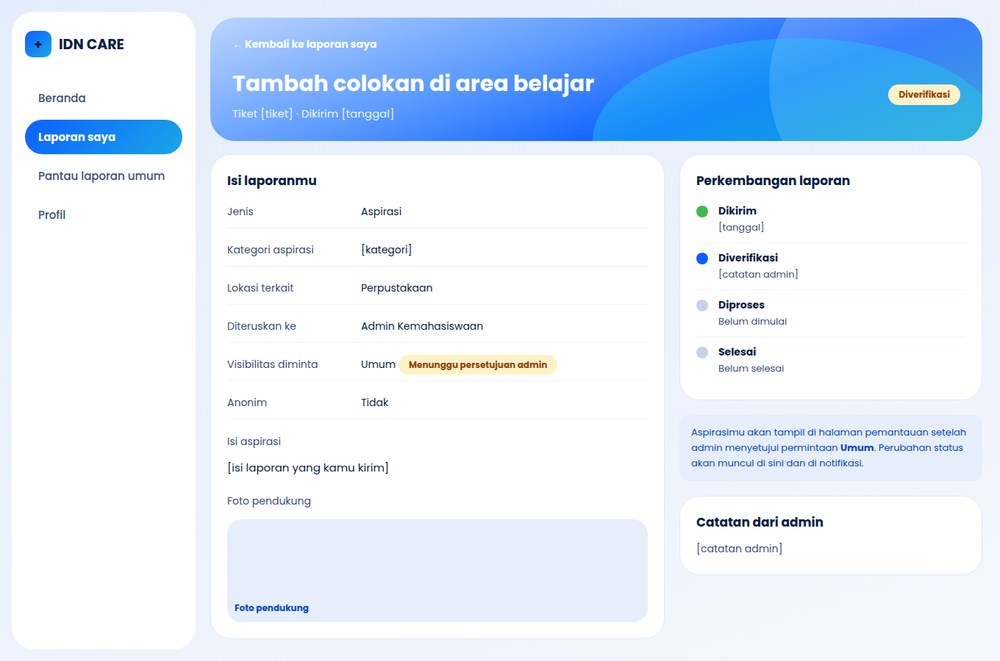

1. Baca hasil tindak lanjut pada laporan berstatus Selesai.
2. Pilih **Konfirmasi** jika hasil sudah sesuai.
3. Jika masalah belum selesai, pilih **Buka kembali**, isi alasan dengan jelas, lalu kirim. Laporan kembali ke proses penanganan.
4. Jika tidak ada respons selama 7 hari sejak penyelesaian, sistem dapat mengonfirmasi otomatis sesuai aturan aplikasi.

### Langkah 8 — Pantau laporan umum

1. Buka **Pantau laporan umum**.
2. Gunakan pilihan jenis atau pencarian untuk menyaring laporan.
3. Hanya laporan fasilitas/aspirasi yang disetujui untuk umum yang muncul. Laporan rahasia, belum disetujui, dan pelanggaran tidak muncul di sini.
4. Buka detail untuk melihat informasi publik yang tersedia. Nama pelapor fasilitas/aspirasi yang memilih anonim disembunyikan.

### Langkah 9 — Profil dan pengaturan tampilan

Profil mahasiswa menampilkan ringkasan laporan miliknya dan informasi akun. Data profil akademik yang dikelola admin bersifat baca saja. Gunakan Pengaturan untuk preferensi tampilan dan menu Notifikasi untuk aktivitas terbaru.

## 4. Panduan Admin Sarpras

### Langkah 1 — Dashboard dan daftar laporan fasilitas
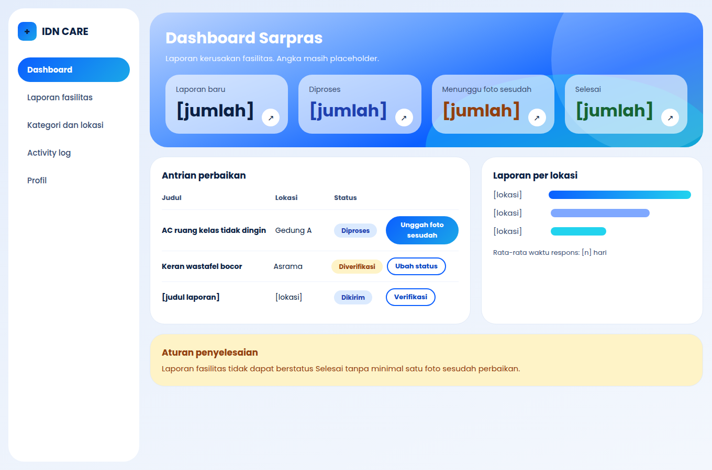

Dashboard merangkum laporan dalam cakupan Sarpras. Admin Sarpras menangani laporan fasilitas; laporan aspirasi dan pelanggaran berada di kewenangan Kemahasiswaan.

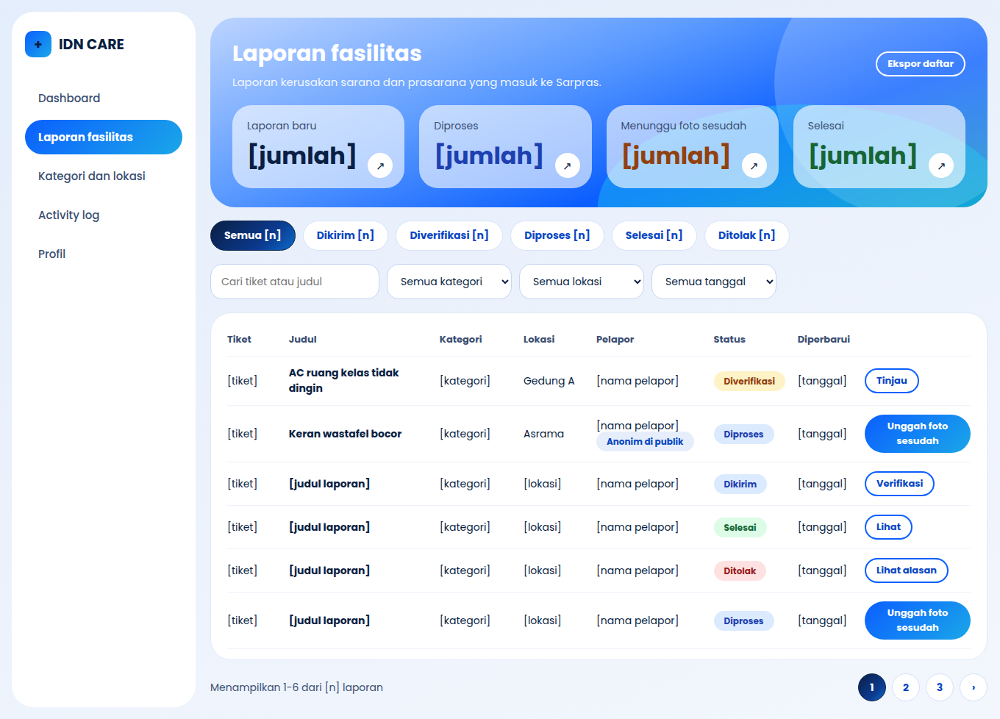

1. Buka **Penanganan laporan**.
2. Saring menurut status, kategori, lokasi, jenis, atau kata kunci/nomor tiket.
3. Buka tiket yang menjadi kewenangan Sarpras untuk memeriksa uraian dan lampiran.

### Langkah 2 — Tinjau detail dan lampiran
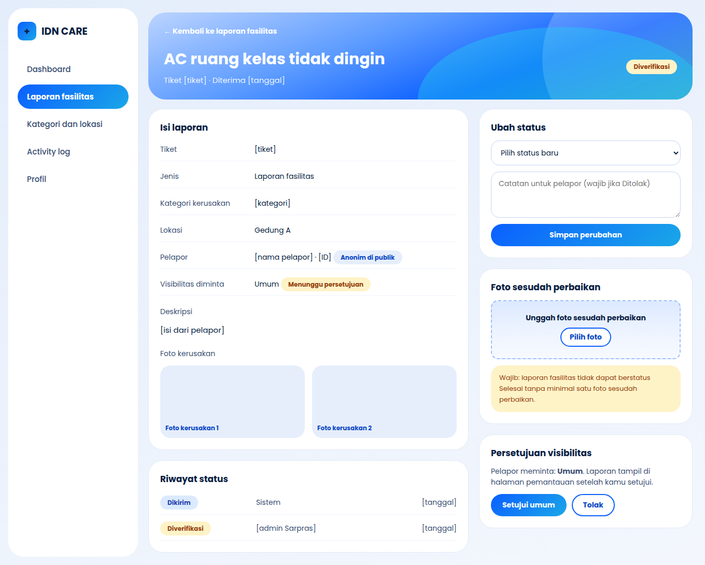

1. Baca kronologi, kategori, lokasi, visibilitas yang diminta, dan riwayat status.
2. Buka foto kondisi awal melalui tombol lampiran. Jika foto tidak terbuka, pastikan Anda login dengan akun admin unit yang berwenang dan gunakan tautan dalam aplikasi.
3. Identitas pelapor hanya ditampilkan sesuai aturan privasi. Jangan menyalin foto atau rincian laporan ke kanal publik.

### Langkah 3 — Perbarui status dan selesaikan laporan

1. Ubah status mengikuti urutan yang tersedia: Dikirim → Diverifikasi → Diproses → Selesai.
2. Jika menolak, isi alasan penolakan sebelum menyimpan.
3. Untuk menandai laporan fasilitas Selesai, lampirkan foto sesudah perbaikan. Server menolak penyelesaian tanpa bukti foto sesudah.
4. Simpan perubahan. Mahasiswa melihat status, catatan yang disediakan, dan riwayat terbaru pada tiketnya.

### Langkah 4 — Putuskan permintaan visibilitas umum

Pada laporan fasilitas yang meminta visibilitas umum, tinjau apakah informasi aman dipublikasikan. Setujui atau tolak permintaan dari detail laporan. Hanya setelah disetujui laporan dapat tampil pada halaman pemantauan umum. Laporan rahasia tidak dipublikasikan.

### Langkah 5 — Kelola kategori fasilitas dan lokasi

1. Buka menu **Kategori** untuk menambah atau mengubah kategori fasilitas sesuai kewenangan.
2. Buka **Lokasi** untuk menambah, mengubah, mengaktifkan, atau menonaktifkan lokasi kampus.
3. Data yang sudah dipakai laporan tidak dapat dihapus. Nonaktifkan agar tidak muncul di form baru; laporan lama tetap menyimpan kategorinya.
4. Simpan perubahan dan periksa notifikasi hasilnya.

### Langkah 6 — Profil, notifikasi, dan activity log
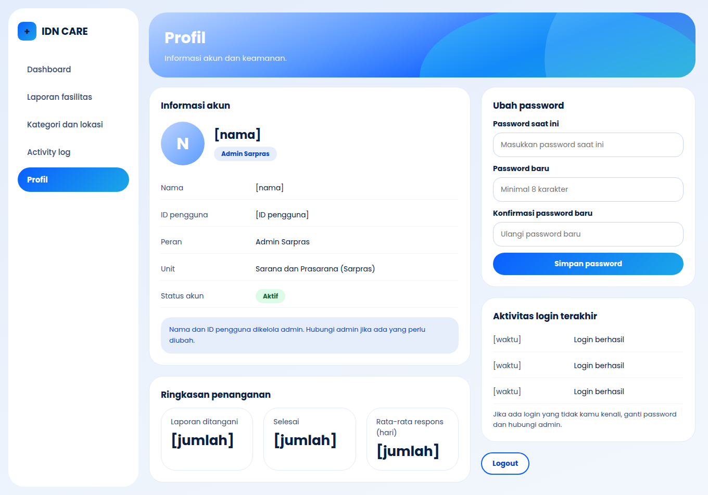

Gunakan Profil untuk melihat ringkasan penanganan, Notifikasi untuk pemberitahuan aplikasi, dan **Log aktivitas** untuk meninjau tindakan yang tercatat. Log merupakan catatan audit, bukan daftar yang dapat diedit atau dihapus.

## 5. Panduan Admin Kemahasiswaan

### Langkah 1 — Dashboard dan antrean laporan
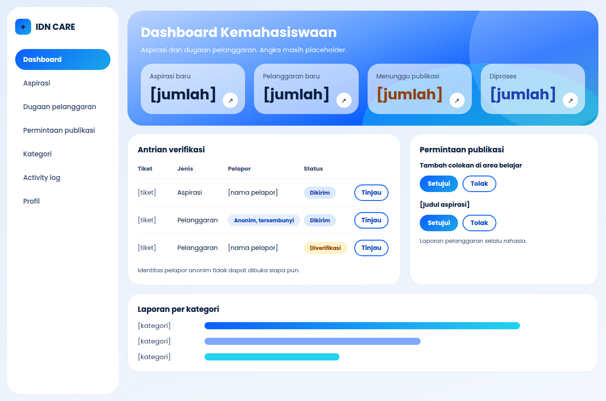

Admin Kemahasiswaan menangani aspirasi dan dugaan pelanggaran. Daftar laporan dapat difilter berdasarkan jenis/status, kategori, lokasi, atau kata kunci. Data mahasiswa dan laporan fasilitas tidak menjadi antrean unit ini.

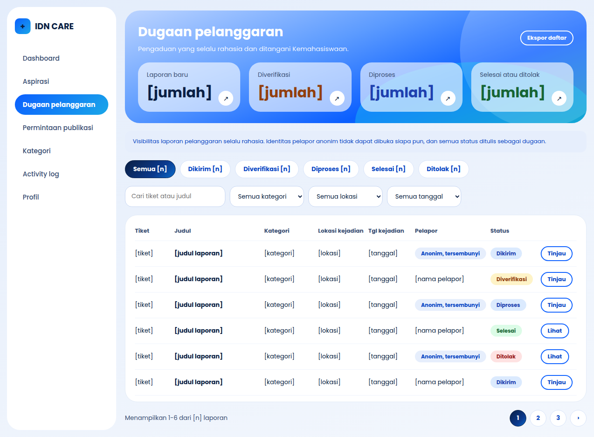

### Langkah 2 — Tinjau aspirasi
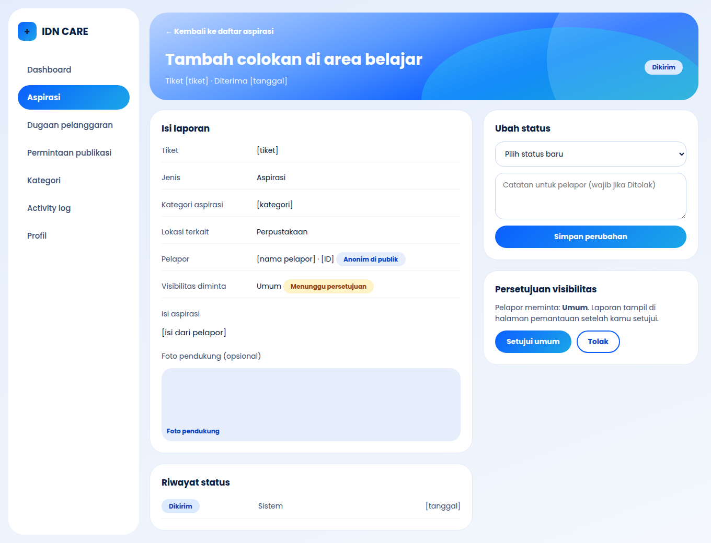

1. Buka tiket aspirasi dan baca uraian, kategori, lampiran, dan riwayatnya.
2. Perbarui status sesuai tahap yang diizinkan. Penolakan mewajibkan alasan.
3. Jika aspirasi meminta visibilitas umum, setujui atau tolak dari detail. Keputusan menentukan apakah aspirasi tampil di pemantauan umum.
4. Mahasiswa melihat status dan keputusan visibilitas pada halaman detail tiket.

### Langkah 3 — Tinjau dugaan pelanggaran dengan perlindungan privasi
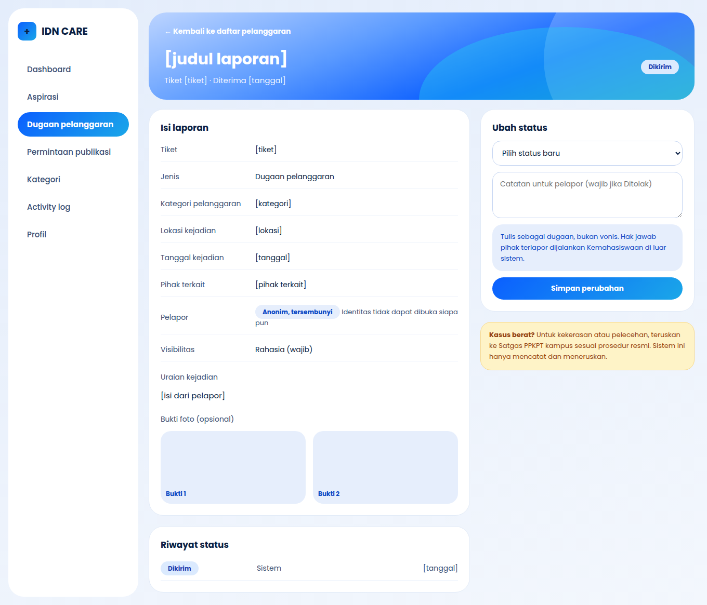

1. Buka detail hanya untuk keperluan penanganan yang sah.
2. Periksa uraian, waktu kejadian, lokasi, lampiran yang diizinkan, dan riwayat status.
3. Laporan selalu rahasia dan tidak dapat disetujui untuk publikasi umum.
4. Jika anonim, aplikasi tidak menampilkan identitas pelapor; jangan mencoba mencari atau menebak identitasnya. Super Admin pun tidak memiliki fungsi untuk membuka identitas tersebut.
5. Perbarui status seperlunya dan masukkan alasan jika laporan ditolak. Mahasiswa memantau dengan tiketnya sendiri.

### Langkah 4 — Kelola kategori dan lokasi

Gunakan menu **Kategori** untuk kategori aspirasi dan pelanggaran yang termasuk kewenangan unit. Gunakan **Lokasi** untuk data tempat bersama. Tambahkan atau ubah data dengan formulir, simpan, dan nonaktifkan data lama yang tidak lagi dipakai. Data yang sudah digunakan laporan dipertahankan.

### Langkah 5 — Profil, notifikasi, dan activity log
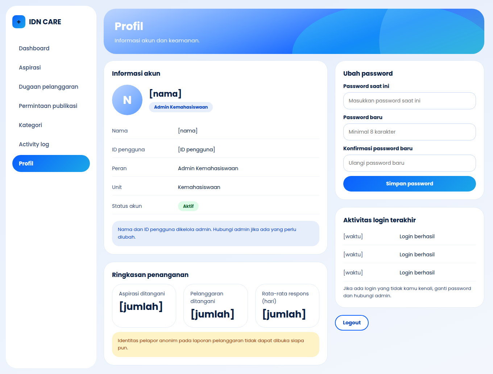

Profil menampilkan ringkasan aspirasi/pelanggaran yang ditangani. Notifikasi menunjukkan pembaruan dalam aplikasi. Log aktivitas dapat dipakai untuk meninjau perubahan operasional yang tercatat; jangan memasukkan informasi sensitif ke catatan atau saluran lain.

## 6. Panduan Super Admin

### Langkah 1 — Dashboard keseluruhan
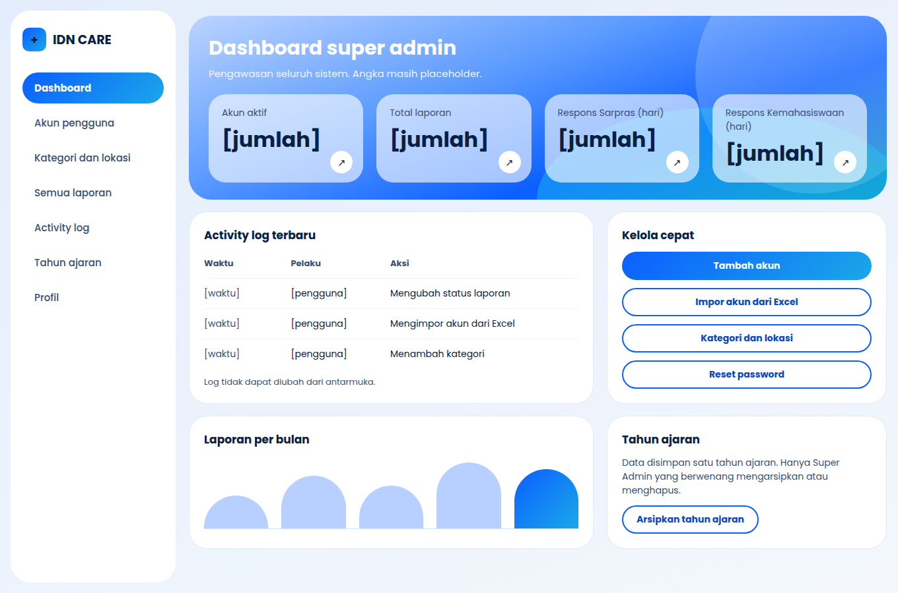

Dashboard Super Admin menyajikan ringkasan yang mencakup semua unit. Grafik atau tabel dapat dibuka untuk memahami distribusi laporan. Jika belum ada data, panel menampilkan keadaan kosong; itu bukan berarti grafik dapat memuat data yang belum tercatat.

### Langkah 2 — Kelola akun pengguna
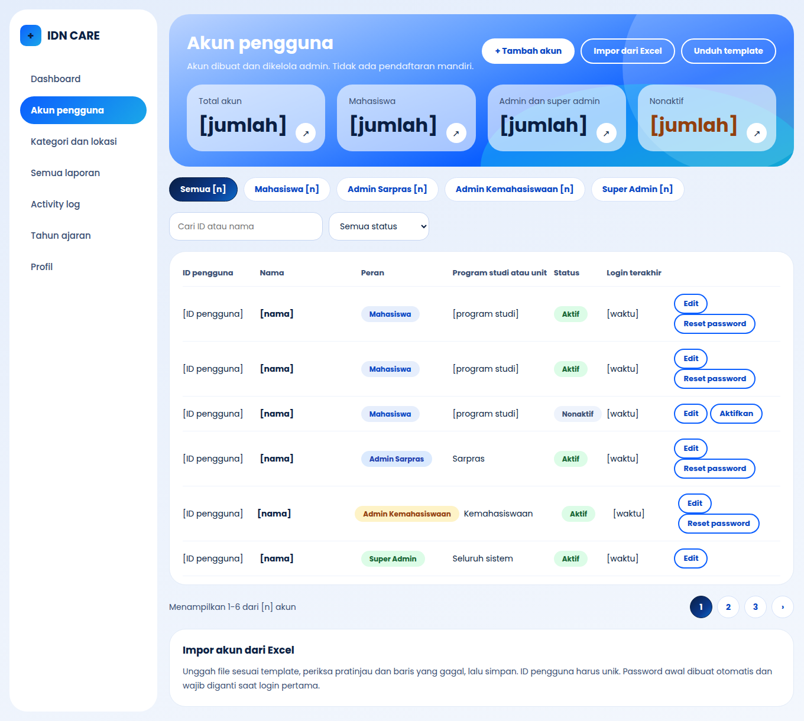

1. Buka **Akun pengguna** untuk mencari akun berdasarkan ID/nama dan melihat role/statusnya.
2. Pilih **Tambah pengguna**, isi ID, nama, role, dan bidang tambahan yang muncul untuk role tertentu. Ganti role akan memperbarui bidang form; isi hanya data yang diwajibkan untuk role terpilih.
3. Simpan akun. Password awal ditampilkan satu kali; salin dan serahkan secara aman kepada pengguna. Tutup dialog password awal hanya setelah disimpan/disalin.
4. Gunakan edit untuk memperbarui data mahasiswa yang diizinkan. Gunakan reset password bila perlu; sampaikan password sementara secara terpisah dan aman.
5. Nonaktifkan akun yang tidak lagi berhak masuk bila fungsi tersedia pada baris akun.

### Langkah 3 — Impor akun dari berkas

1. Buka menu impor pengguna.
2. Unduh atau siapkan template sesuai kolom yang ditunjukkan aplikasi.
3. Periksa ID unik, nama, role dan data mahasiswa sebelum memilih berkas.
4. Unggah berkas dan baca ringkasan validasi. Koreksi baris yang ditolak; jangan menganggap berkas berhasil seluruhnya sebelum memeriksa hasil impor.
5. Bagikan kredensial awal melalui kanal aman, bukan dokumen publik atau screenshot.

### Langkah 4 — Tinjau dan kelola seluruh laporan
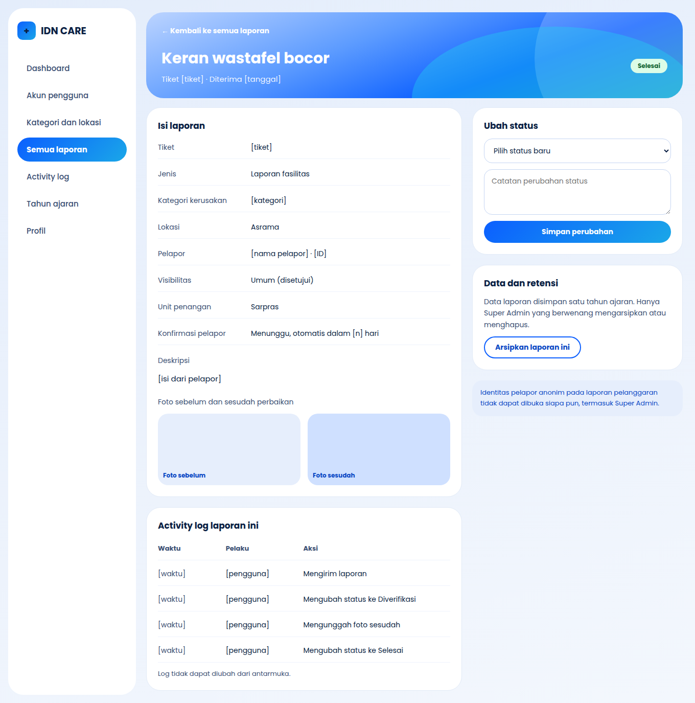

Super Admin dapat meninjau daftar lintas unit dan detail untuk membantu pengawasan. Gunakan filter dan pencarian seperti admin unit. Keputusan status tetap harus mengikuti aturan bisnis dan disertai alasan penolakan bila diperlukan. Laporan fasilitas tetap membutuhkan foto sesudah sebelum ditandai Selesai.

**Batas privasi:** akses lintas unit tidak mengizinkan pembukaan identitas pelapor anonim pada laporan pelanggaran. Jangan mencoba menghubungkan token anonim dengan akun.

### Langkah 5 — Kelola kategori, lokasi, dan log

Super Admin dapat mengelola kategori dan lokasi lintas jenis laporan sesuai kontrol yang tersedia. Data yang sudah terpakai dipertahankan dan dapat dinonaktifkan. Menu log aktivitas dipakai untuk audit; log bersifat historis dan tidak boleh diubah atau dihapus melalui aplikasi.

### Langkah 6 — Atur layanan, menu laporan, dan pengumuman

1. Buka **Pengaturan sistem**. Ubah nama/identitas situs, tagline, kontak, atau logo jika diperlukan.
2. Aktifkan/nonaktifkan jenis laporan Fasilitas, Aspirasi, dan Pelanggaran. Tekan **Simpan** agar perubahan berlaku pada dashboard, sidebar, dan form mahasiswa.
3. Kelola pengumuman berjalan: aktifkan tampilannya, tulis pesan utama, tambahkan pesan lain dengan tombol **+**, atur kecepatan, lalu simpan. Pengumuman dapat ditutup pengguna dan preferensi tutup berlaku di browser tersebut.
4. Ubah judul utama, judul kedua, subteks, dan tulisan “Coming Soon” pada pesan maintenance. Simpan bagian pesan maintenance secara khusus, lalu gunakan pratinjau untuk memeriksa hasil.
5. Aktifkan mode maintenance hanya saat layanan memang perlu dihentikan. Pastikan akses Super Admin tetap tersedia untuk mengelola situs.
6. Setelah menyimpan, periksa beranda publik dan dashboard pengguna pada tab baru. Jika perubahan tidak tampak, muat ulang halaman dan periksa status penyimpanannya.

### Langkah 7 — Pengarsipan berdasarkan tahun ajaran

1. Buka **Arsip**.
2. Pilih rentang/tahun ajaran yang akan diarsipkan dan tinjau jumlah data sebelum melanjutkan.
3. Konfirmasi hanya setelah memeriksa periode. Laporan terarsip tidak tampil sebagai data aktif, tetapi tetap dipertahankan untuk riwayat sesuai kebijakan aplikasi.
4. Gunakan daftar arsip untuk meninjau data historis. Jangan melakukan penghapusan massal tanpa prosedur persetujuan institusi.

### Langkah 8 — Profil, password, dan sesi
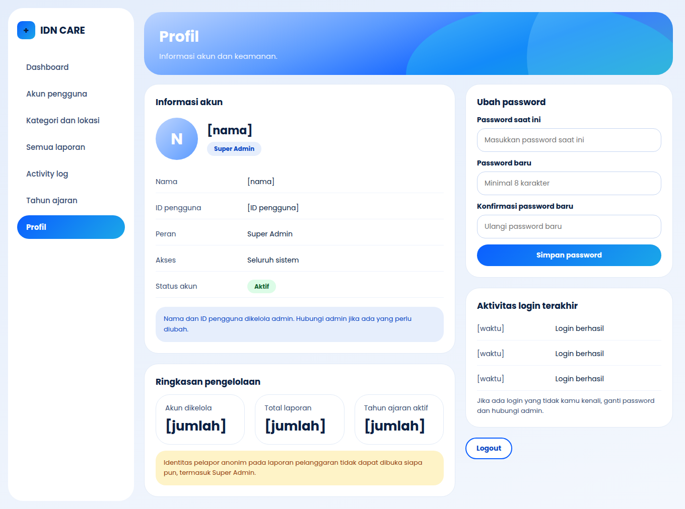

Gunakan Profil untuk ringkasan pengelolaan dan riwayat login yang tersedia. Ganti password dari alur yang disediakan. Keluar setelah selesai memakai perangkat bersama; jangan menyimpan sesi admin di komputer umum.

## 7. Apa yang terjadi setelah laporan dikirim

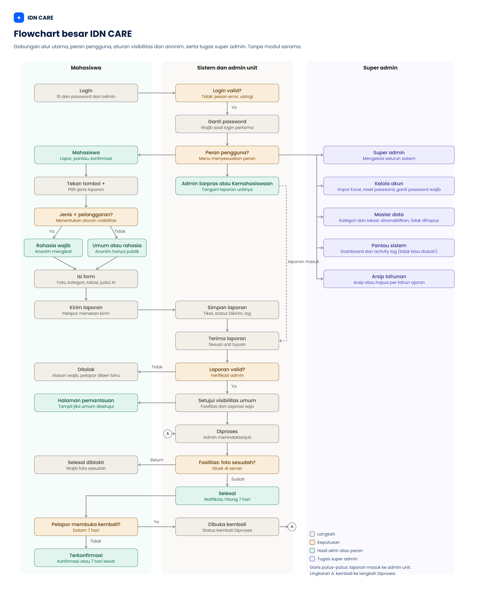

1. **Mahasiswa mengirim** formulir yang valid dan menerima nomor tiket.
2. **Sistem mengarahkan** fasilitas ke Sarpras serta aspirasi/pelanggaran ke Kemahasiswaan.
3. **Admin unit meninjau** laporan dan memperbarui status. Penolakan memerlukan alasan.
4. **Mahasiswa menerima pemberitahuan** di dalam aplikasi dan dapat membuka detail tiket.
5. Untuk fasilitas, admin melampirkan foto sesudah sebelum status Selesai dapat disimpan.
6. Untuk aspirasi/fasilitas umum, admin memutuskan permintaan visibilitas. Hanya yang disetujui yang tampil di pemantauan.
7. Mahasiswa mengonfirmasi hasil atau membuka kembali laporan Selesai dengan alasan. Tanpa respons, konfirmasi otomatis dapat terjadi setelah tujuh hari.

| Yang dilakukan Admin | Yang terlihat oleh Mahasiswa |
|---|---|
| Mengubah status | Status dan riwayat tiket diperbarui |
| Menolak laporan dengan alasan | Alasan penolakan tampil pada detail sesuai aplikasi |
| Mengunggah foto sesudah fasilitas | Lampiran hasil dapat dilihat pemilik laporan yang berhak |
| Menyetujui visibilitas umum | Laporan fasilitas/aspirasi dapat muncul di pemantauan publik |
| Menolak permintaan publikasi | Laporan tidak muncul pada pemantauan umum |
| Menangani pelanggaran anonim | Tiket tetap tersedia bagi pelapor; identitas tidak ditampilkan ke admin |

## 8. Pemecahan masalah dan praktik privasi

| Gejala | Yang perlu diperiksa |
|---|---|
| Tidak bisa masuk | Pastikan ID benar, password benar, akun aktif, dan gunakan halaman login resmi. Minta admin mereset password jika perlu. |
| Diarahkan untuk mengganti password | Selesaikan perubahan password wajib; menu lain memang dibatasi sampai selesai. |
| Jenis laporan tidak dapat dibuka | Super Admin mungkin menonaktifkan jenis laporan. Periksa pengumuman resmi atau hubungi pengelola. |
| Kategori/lokasi tidak muncul | Pastikan data aktif dan sesuai jenis laporan; lokasi/kategori yang nonaktif tidak tersedia untuk laporan baru. |
| Foto gagal diunggah | Gunakan JPG/JPEG/PNG, maksimal 4 MB per foto, maksimal 5 foto. Pilih ulang file jika proses unggah dibatalkan. |
| Foto lampiran tidak terbuka | Masuk dengan akun yang berhak dan buka melalui tombol lampiran pada tiket. Lampiran privat tidak dapat dibuka melalui tautan umum. |
| Tombol simpan memberi kesalahan | Baca pesan validasi di dekat kolom, isi semua kolom wajib, dan coba simpan kembali. |
| Status belum berubah | Muat ulang detail tiket, periksa koneksi, dan pastikan notifikasi sukses muncul. Hubungi admin jika status tetap lama. |
| Grafik kosong | Periksa rentang data dan filter. Grafik kosong bila belum ada data dalam cakupan tersebut. |
| Perubahan maintenance/pengumuman belum tampak | Simpan bagian pengaturan yang benar, muat ulang halaman, dan periksa apakah fitur sedang aktif. |

**Jaga kerahasiaan:** jangan membagikan password, tiket rahasia, foto bukti, atau tangkapan layar yang memuat identitas. Jangan memasukkan identitas pelapor anonim pelanggaran pada percakapan atau log eksternal. Gunakan kanal resmi institusi untuk keadaan darurat; IDN CARE adalah sarana pencatatan dan tindak lanjut, bukan pengganti layanan darurat.

---

Panduan ini menjelaskan alur produk dan akses berdasarkan role. Jika tampilan berubah setelah pembaruan aplikasi, ikuti label serta petunjuk yang tampil pada versi terbaru dan laporkan ketidaksesuaian kepada pengelola IDN CARE.
